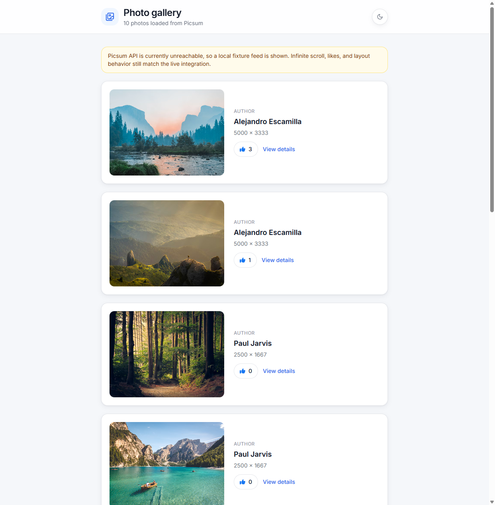

# Exactspace Technologies — React Internship Assignments

Professional frontend implementations of the Exactspace Technologies Pvt. Ltd. (Bangalore) React internship assignments:

1. **Chat App** — team messaging UI with likes, emoji picker, and `@mentions`
2. **Photo Gallery** — single-column infinite-scroll feed powered by the Picsum Photos API

Both apps are production-buildable Vite + React applications with polished light/dark UI, accessibility support, and clean component architecture.

---

## Assignment overview

| App | Folder | Focus |
| --- | --- | --- |
| Chat App | `chat-app/` | Message thread, random usernames, likes, stretch goals |
| Photo Gallery | `photo-gallery/` | Paginated API feed, infinite scroll, Font Awesome likes |

Original assignment instructions are preserved:

- `chat-app/reactjs_chat_assignment.md`
- `photo-gallery/reactjs_photo_gallery_assignment.md`

Reference assets are also preserved under each app folder.

---

## Chat App features

### Mandatory

- Message input + send button
- Real-time UI update on send
- Auto-scroll to latest message
- Enter to send / Shift+Enter for newline
- Empty message validation + whitespace trimming
- Random username per message from `["Alan", "Bob", "Carol", "Dean", "Elin"]`
- Avatar, username, timestamp, like button, like count
- Independent like counters that increment on every click

### Optional / stretch

- Searchable emoji picker with cursor-aware insertion
- `@mention` dropdown with filtering + keyboard navigation
- Mention highlighting inside messages
- Light/dark theme toggle
- LocalStorage message persistence
- Copy message action
- Smooth message entrance animations
- Empty/welcome state

### Not implemented

- Socket.IO realtime server (optional stretch goal #3) — intentionally skipped so the mandatory local chat experience remains reliable and self-contained

---

## Photo Gallery features

### Mandatory

- Live Picsum API integration (`/v2/list?page=N`)
- Single-column feed layout
- Image via `download_url`, author via `author`
- Infinite scrolling with Intersection Observer
- Append-only pagination until empty page
- Font Awesome thumbs-up icon
- Independent like counters starting at 0 and incrementing on every click

### Enhancements

- Skeleton loaders + image placeholders
- Loading spinner for subsequent pages
- Error state with retry
- End-of-gallery message
- Image load failure fallback
- Photo detail modal
- Light/dark theme
- LocalStorage like persistence
- Scroll-to-top button
- Native lazy loading

---

## Tech stack

- React 19 + Vite
- JavaScript (ES6+)
- Tailwind CSS v4
- Lucide React (general icons)
- Font Awesome (`faThumbsUp` for gallery likes)
- Motion for React (subtle animations)
- Fetch API
- Intersection Observer API
- LocalStorage

---

## Project architecture

```text
react-assignments/
├── chat-app/
│   ├── assets/                          # original assignment GIF
│   ├── reactjs_chat_assignment.md       # original brief
│   ├── src/
│   │   ├── components/
│   │   ├── hooks/
│   │   ├── utils/
│   │   ├── App.jsx
│   │   ├── main.jsx
│   │   └── index.css
│   ├── index.html
│   ├── package.json
│   └── vite.config.js
├── photo-gallery/
│   ├── photo-gallery.jpg                # original reference
│   ├── reactjs_photo_gallery_assignment.md
│   ├── public/fixtures/picsum/          # offline fallback pages if Picsum is down
│   ├── vite-picsum-proxy.js             # Vite middleware: live API first, fixture fallback
│   ├── src/
│   │   ├── components/
│   │   ├── hooks/
│   │   ├── utils/
│   │   ├── App.jsx
│   │   ├── main.jsx
│   │   └── index.css
│   ├── index.html
│   ├── package.json
│   └── vite.config.js
├── screenshots/                         # captured UI shots from running apps
├── README.md
└── .gitignore
```

---

## Installation

### Chat App

```bash
cd chat-app
npm install
```

### Photo Gallery

```bash
cd photo-gallery
npm install
```

---

## Run locally

### Chat App

```bash
cd chat-app
npm run dev
```

### Photo Gallery

```bash
cd photo-gallery
npm run dev
```

Each Vite server prints a local URL (typically `http://localhost:5173`).

---

## Build & lint

### Chat App

```bash
cd chat-app
npm run build
npm run lint
npm run preview
```

### Photo Gallery

```bash
cd photo-gallery
npm run build
npm run lint
npm run preview
```

---

## API explanation (Photo Gallery)

Photos are loaded from the public Picsum Photos list endpoint:

```text
https://picsum.photos/v2/list?page=1&limit=10
https://picsum.photos/v2/list?page=2&limit=10
https://picsum.photos/v2/list?page=3&limit=10
```

Each item exposes:

- `download_url` — image URL rendered in the card
- `author` — photographer attribution
- `id`, `width`, `height`, `url` — metadata used for keys, sizing, and detail modal

When the user approaches the bottom sentinel, the next page is requested and appended. Pagination stops when the API returns an empty array. Duplicate IDs are filtered client-side.

---

## Testing instructions

### Chat checklist

1. Send a valid message — it appears immediately with a random username.
2. Try sending empty / whitespace-only text — it is blocked.
3. Click likes repeatedly — count increases `0 → 1 → 2 → …` independently per message.
4. Open the emoji picker, search, and insert an emoji at the caret.
5. Type `@` and navigate users with arrow keys / Enter.
6. Toggle theme and refresh — theme + messages persist.

### Gallery checklist

1. Page 1 loads from Picsum with authors and images.
2. Layout remains one column on mobile and desktop.
3. Scroll to bottom — page 2+ appends without replacing prior photos.
4. Click Font Awesome thumbs-up repeatedly — likes increment independently.
5. Trigger/retry error states if needed (network throttle).
6. Open a photo detail modal and close with Escape / backdrop click.

---

## Screenshots

Captured from the running local apps:

| App | Screenshot |
| --- | --- |
| Chat (light) | `screenshots/chat-light.png` |
| Gallery (light) | `screenshots/gallery-light.png` |




---

## Deployment

Both apps are static Vite builds and can be deployed independently to Vercel or Netlify.

### Vercel (recommended)

From each app directory:

```bash
npm run build
```

Deploy the generated `dist/` folder, or connect the GitHub repo and set the project root to `chat-app` or `photo-gallery`.

Build command: `npm run build`  
Output directory: `dist`

No secrets are required. Gallery requests go directly to the public Picsum API.

### Netlify

Same approach: set base directory to `chat-app` or `photo-gallery`, build command `npm run build`, publish directory `dist`.

---

## Known limitations

- Chat messages are local-only (no Socket.IO backend). Socket.IO stretch goal was intentionally not implemented.
- Gallery likes persist in LocalStorage per browser only.
- Picsum availability / rate limits depend on the public API. During development, `picsum.photos` returned Cloudflare **HTTP 522** from this network. The gallery still prefers the live Picsum API first; if it is unreachable, a same-shape local fixture feed is used so infinite scroll / likes remain testable. A banner indicates when fallback mode is active.
- Very large local chat histories can grow LocalStorage usage over time.

---

## Publishing this repository

When you are ready (do **not** push without your approval in this workflow):

1. Create a public GitHub repository.
2. Commit the project files.
3. Push to GitHub.
4. Share the repository URL with Exactspace over email.

---

## License / attribution

Assignment brief © Exactspace Technologies.  
Photo data © photographers via [Lorem Picsum](https://picsum.photos/).
