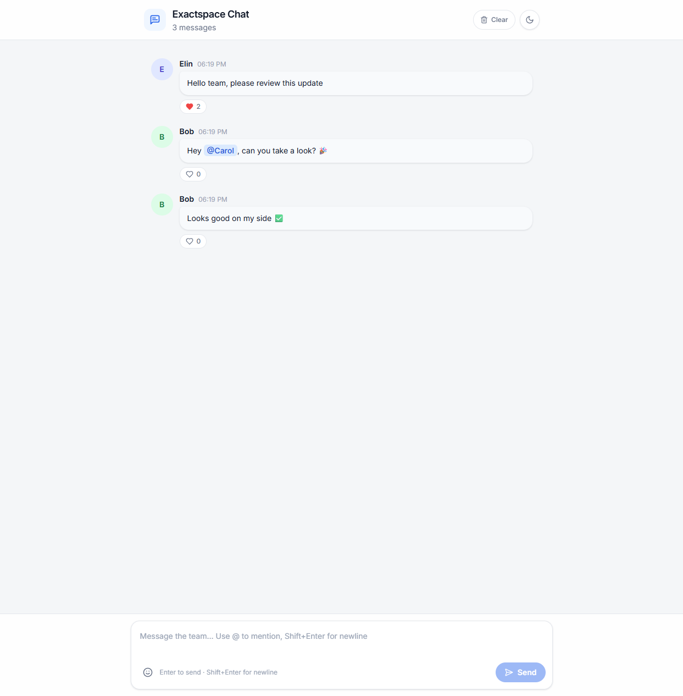
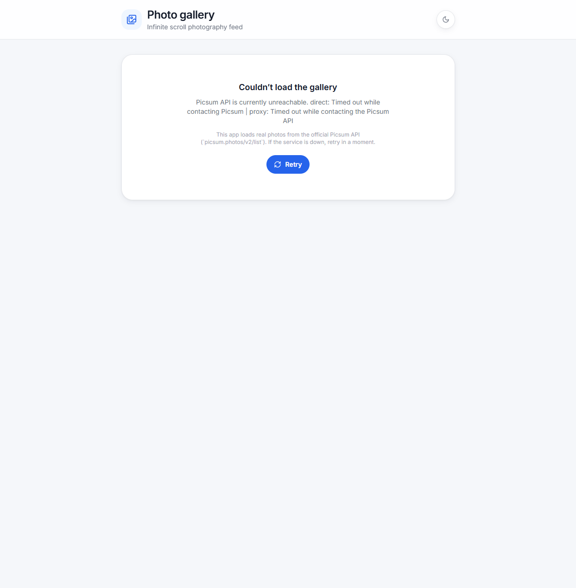
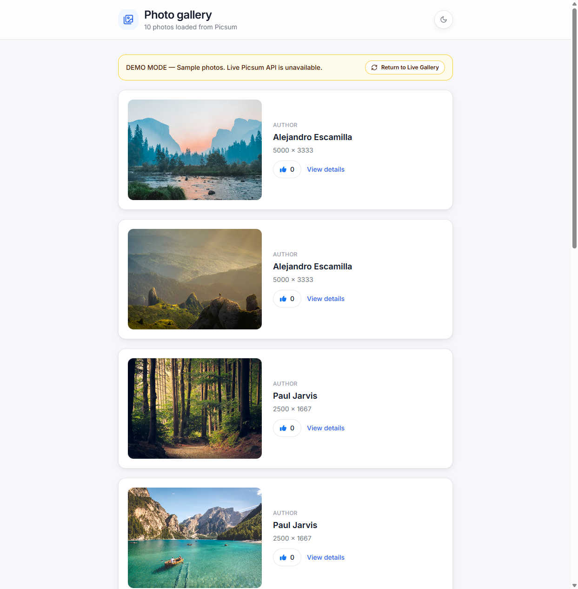

# Exactspace Technologies — React Internship Assignments

Professional frontend implementations of the Exactspace Technologies Pvt. Ltd. (Bangalore) React internship assignments:

1. **Chat App** — team messaging UI with likes, emoji picker, and `@mentions`
2. **Photo Gallery** — single-column infinite-scroll feed powered by the Picsum Photos API

Both apps are production-buildable Vite + React applications with polished light/dark UI, accessibility support, and clean component architecture.

---

## Assignment overview

| App | Folder | Focus |
| --- | --- | --- |
| Chat App | `chat-app/` | Message thread, random usernames, likes, stretch goals |
| Photo Gallery | `photo-gallery/` | Paginated API feed, infinite scroll, Font Awesome likes |

Original assignment instructions are preserved:

- `chat-app/reactjs_chat_assignment.md`
- `photo-gallery/reactjs_photo_gallery_assignment.md`

Reference assets are also preserved under each app folder.

---

## Chat App features

### Mandatory

- Message input + send button
- Real-time UI update on send
- Auto-scroll to latest message
- Enter to send / Shift+Enter for newline
- Empty message validation + whitespace trimming
- Random username per message from `["Alan", "Bob", "Carol", "Dean", "Elin"]`
- Avatar, username, timestamp, like button, like count
- Independent like counters that increment on every click

### Optional / stretch

- Searchable emoji picker with cursor-aware insertion
- `@mention` dropdown with filtering + keyboard navigation
- Mention highlighting inside messages
- Light/dark theme toggle
- LocalStorage message persistence
- Copy message action
- Smooth message entrance animations
- Empty/welcome state

### Not implemented

- Socket.IO realtime server (optional stretch goal #3) — intentionally skipped so the mandatory local chat experience remains reliable and self-contained

---

## Photo Gallery features

### Mandatory

- Live Picsum API integration (`/v2/list?page=N`)
- Single-column feed layout
- Image via `download_url`, author via `author`
- Infinite scrolling with Intersection Observer
- Append-only pagination until empty page
- Font Awesome thumbs-up icon
- Independent like counters starting at 0 and incrementing on every click

### Enhancements

- Skeleton loaders + image placeholders
- Loading spinner for subsequent pages
- Error state with retry
- End-of-gallery message
- Image load failure fallback
- Photo detail modal
- Light/dark theme
- LocalStorage like persistence
- Scroll-to-top button
- Native lazy loading

---

## Tech stack

- React 19 + Vite
- JavaScript (ES6+)
- Tailwind CSS v4
- Lucide React (general icons)
- Font Awesome (`faThumbsUp` for gallery likes)
- Motion for React (subtle animations)
- Fetch API
- Intersection Observer API
- LocalStorage

---

## Project architecture

```text
react-assignments/
├── chat-app/
│   ├── assets/                          # original assignment GIF
│   ├── reactjs_chat_assignment.md       # original brief
│   ├── src/
│   │   ├── components/
│   │   ├── hooks/
│   │   ├── utils/
│   │   ├── App.jsx
│   │   ├── main.jsx
│   │   └── index.css
│   ├── index.html
│   ├── package.json
│   └── vite.config.js
├── photo-gallery/
│   ├── photo-gallery.jpg                # original reference
│   ├── reactjs_photo_gallery_assignment.md
│   ├── api/picsum.js                    # Vercel serverless live Picsum proxy
│   ├── vite-picsum-proxy.js             # Dev/preview live-only Picsum proxy
│   ├── src/
│   │   ├── components/
│   │   ├── hooks/                       # includes usePhotos.test.js (mocked)
│   │   ├── utils/                       # includes api.test.js (mocked)
│   │   ├── test/                        # Picsum-shaped fixtures for tests only
│   │   ├── App.jsx
│   │   ├── main.jsx
│   │   └── index.css
│   ├── index.html
│   ├── package.json
│   └── vite.config.js
├── screenshots/                         # chat working + gallery API-unavailable
├── README.md
└── .gitignore
```

---

## Installation

### Chat App

```bash
cd chat-app
npm install
```

### Photo Gallery

```bash
cd photo-gallery
npm install
```

---

## Run locally

### Chat App

```bash
cd chat-app
npm run dev
```

### Photo Gallery

```bash
cd photo-gallery
npm run dev
```

Each Vite server prints a local URL (typically `http://localhost:5173`).

---

## Build & lint

### Chat App

```bash
cd chat-app
npm run build
npm run lint
npm run preview
```

### Photo Gallery

```bash
cd photo-gallery
npm run build
npm run lint
npm run preview
```

---

## API explanation (Photo Gallery)

Photos are loaded from the public Picsum Photos list endpoint:

```text
https://picsum.photos/v2/list?page=1&limit=10
https://picsum.photos/v2/list?page=2&limit=10
https://picsum.photos/v2/list?page=3&limit=10
```

Each item exposes:

- `download_url` — image URL rendered in the card
- `author` — photographer attribution
- `id`, `width`, `height`, `url` — metadata used for keys, sizing, and detail modal

When the user approaches the bottom sentinel, the next page is requested and appended. Pagination stops when the API returns an empty array. Duplicate IDs are filtered client-side.

---

## Testing instructions

### Automated gallery tests (mocked Picsum schema)

From `photo-gallery/`:

```bash
npm test
```

These Vitest tests mock HTTP responses that follow the **real Picsum `/v2/list` schema** (`id`, `author`, `download_url`, etc.). They verify:

- page 1 / page 2 / page 3 fetching
- append-only pagination
- duplicate ID filtering
- stop condition when the API returns `[]`
- independent unlimited likes
- no overlapping `loadMore` requests

**Important:** Vitest mocks are restricted to automated tests under `photo-gallery/src/**/*.test.js` and `photo-gallery/src/test/`.

### Live Picsum vs Demo Mode vs test mocks

| Mode | When it runs | Data source |
| --- | --- | --- |
| **Live Gallery** (default) | Always tried first | Official `https://picsum.photos/v2/list` only |
| **Demo Mode** | Only after user clicks **View Demo Gallery** | Local JSON under `photo-gallery/public/demo/picsum/` (Picsum-shaped). Image files are served from Unsplash CDN URLs, so **Demo Mode still needs internet for photographs**, but it does **not** call Picsum. |
| **Vitest mocks** | `npm test` only | In-memory Picsum-shaped fixtures — never shown as the live gallery |

On live failure the UI shows **Retry Live API** and optional **View Demo Gallery**. Demo Mode shows a persistent banner:

> DEMO MODE — Sample photos. Live Picsum API is unavailable.

**Return to Live Gallery** exits demo mode and retries the official API. Live likes and demo likes are stored separately.

| Kind | What it proves | Current status in this environment |
| --- | --- | --- |
| Live Picsum requests | Real network responses from `https://picsum.photos/v2/list` | **Blocked** — upstream timeouts (no HTTP body) |
| Demo Mode gallery | Explicit sample feed with visible photos | Available via **View Demo Gallery** |
| Mocked integration tests | App logic against Picsum-shaped JSON | **Passing** (`npm test`) |

### Chat checklist (manual)

1. Send a valid message — it appears immediately with a random username.
2. Try sending empty / whitespace-only text — it is blocked.
3. Click likes repeatedly — count increases `0 → 1 → 2 → …` independently per message.
4. Open the emoji picker, search, and insert an emoji at the caret.
5. Type `@` and navigate users with arrow keys / Enter.
6. Toggle theme and refresh — theme + messages persist.

### Gallery checklist (manual / live)

1. Page 1 loads from Picsum with authors and images (**requires live API**).
2. Layout remains one column on mobile and desktop.
3. Scroll to bottom — page 2+ appends without replacing prior photos (**requires live API**).
4. Click Font Awesome thumbs-up repeatedly — likes increment independently.
5. If Picsum is down — error state + Retry (no sample photos).
6. Open a photo detail modal and close with Escape / backdrop click (**requires loaded photos**).

---

## Screenshots

Captured from the running local apps:

| App | Screenshot | Notes |
| --- | --- | --- |
| Chat (light) | `screenshots/chat-light.png` | Working chat UI |
| Gallery API unavailable | `screenshots/gallery-api-unavailable.png` | Live error state while Picsum times out |
| Gallery Demo Mode | `screenshots/gallery-demo-mode.png` | **Demo sample photos** (not live Picsum) |







---

## Deployment

Both apps are static Vite builds and can be deployed independently to Vercel or Netlify.

### Vercel (recommended)

From each app directory:

```bash
npm run build
```

Deploy the generated `dist/` folder, or connect the GitHub repo and set the project root to `chat-app` or `photo-gallery`.

Build command: `npm run build`  
Output directory: `dist`

No secrets are required. Gallery requests go directly to the public Picsum API.

### Netlify

Same approach: set base directory to `chat-app` or `photo-gallery`, build command `npm run build`, publish directory `dist`.

---

## Known limitations

- Chat messages are local-only (no Socket.IO backend). Socket.IO stretch goal was intentionally not implemented.
- Gallery likes persist in LocalStorage per browser only.
- Gallery photos come **only** from the live Picsum API (`https://picsum.photos/v2/list`). There is no silent sample-data fallback. If Picsum is unreachable, the UI shows an error with Retry.
- **Upstream outage (observed during submission prep):** requests to `https://picsum.photos/v2/list` timed out from this network (and from external fetch checks), so **live image rendering and live infinite-scroll verification could not be completed**. Mocked tests still validate pagination/likes against Picsum-shaped responses.
- Fetch order: direct HTTPS to Picsum first (with limited exponential-backoff retries), then optional same-origin `/api/picsum` proxy. Production does not depend on Vite’s dev middleware; Vercel can serve `api/picsum.js` when a server-side hop is needed.
- Very large local chat histories can grow LocalStorage usage over time.

---

## Publishing this repository

When you are ready (do **not** push without your approval in this workflow):

1. Create a public GitHub repository.
2. Commit the project files.
3. Push to GitHub.
4. Share the repository URL with Exactspace over email.

---

## License / attribution

Assignment brief © Exactspace Technologies.  
Photo data © photographers via [Lorem Picsum](https://picsum.photos/).
